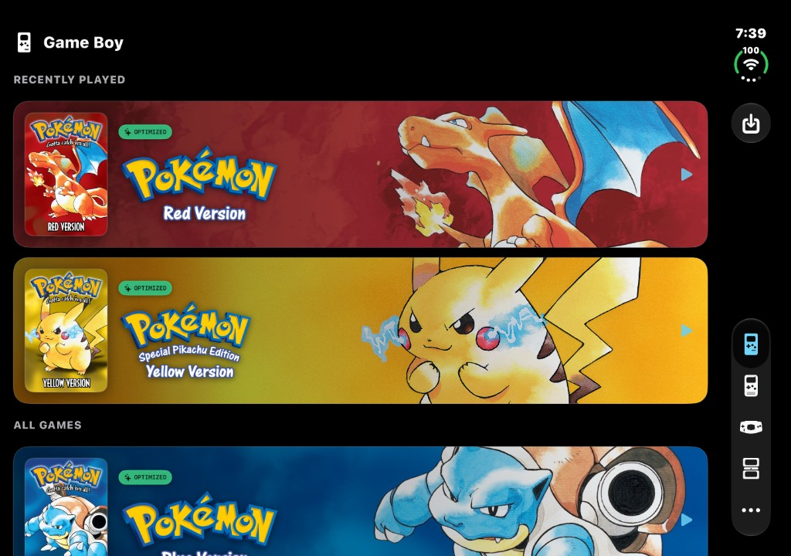
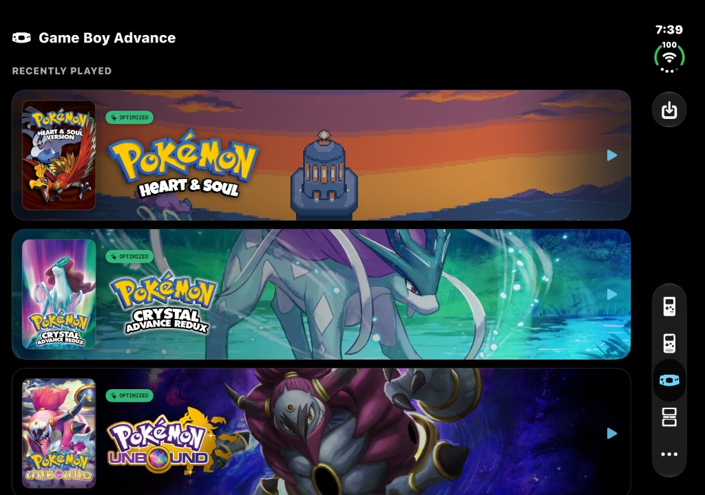
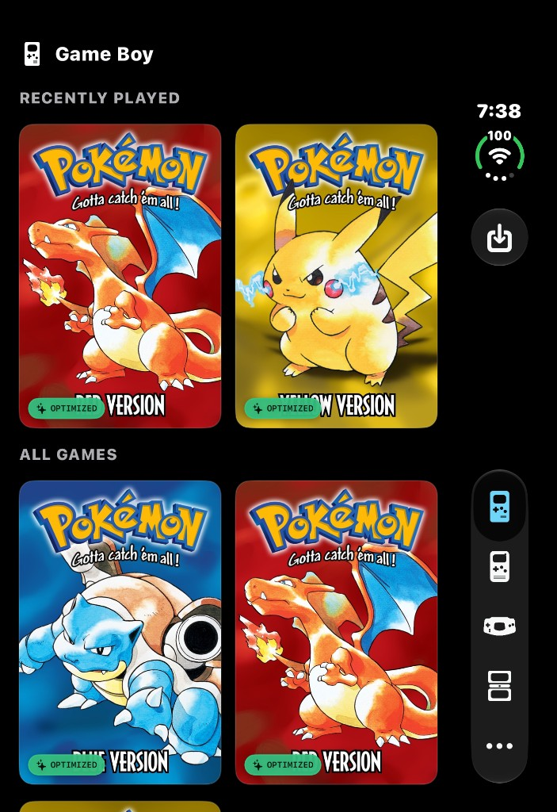
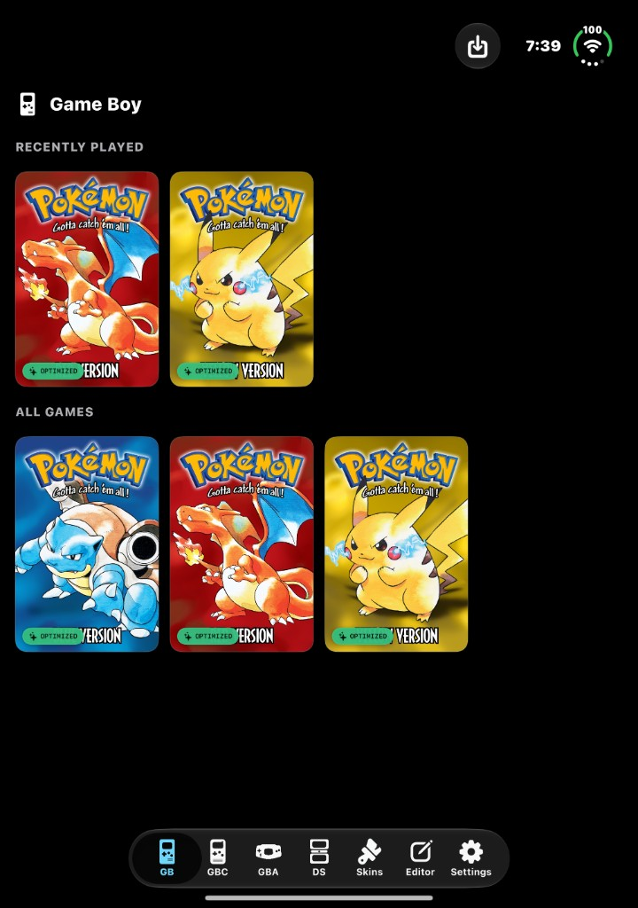
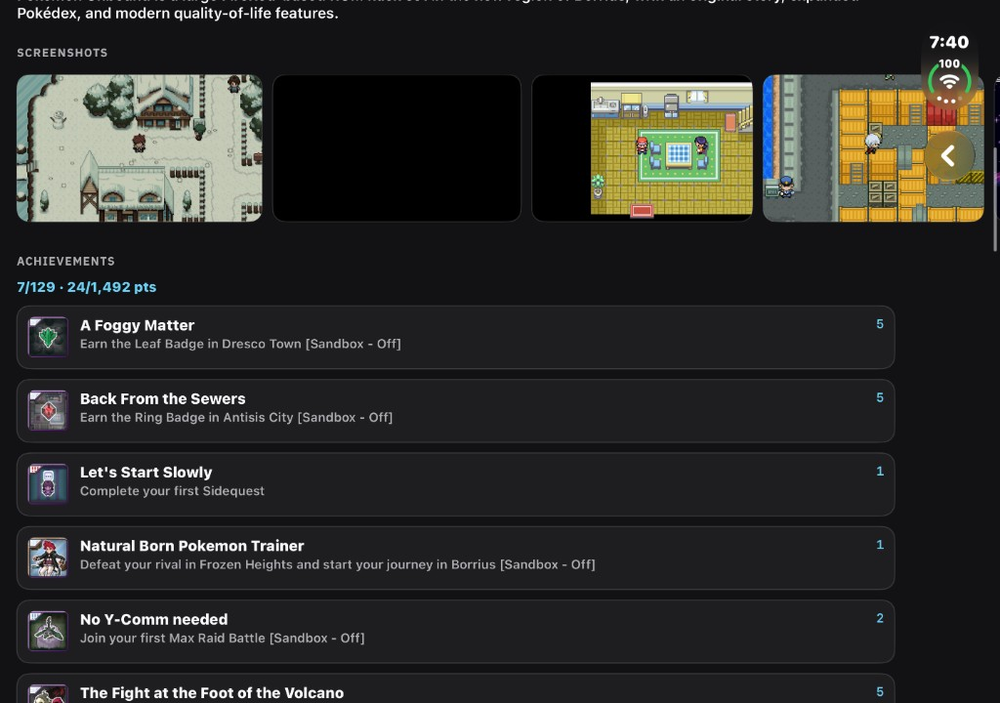
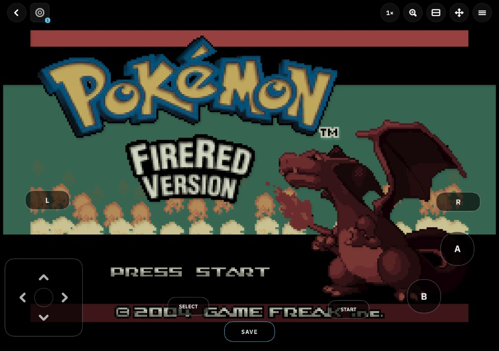
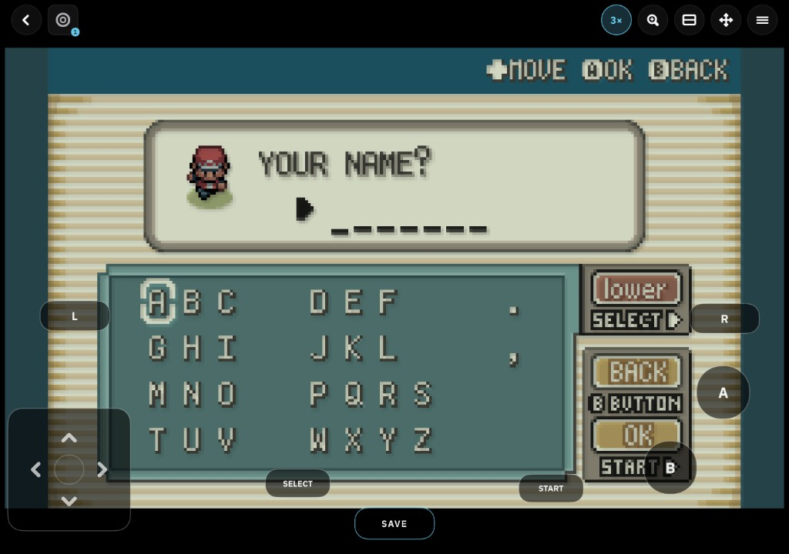
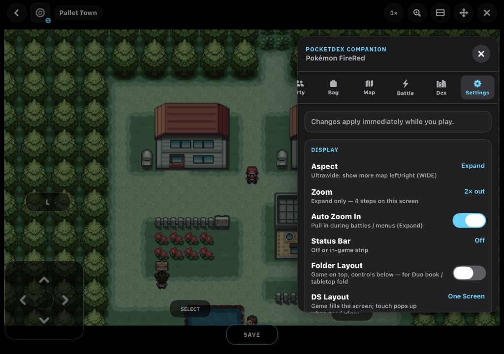
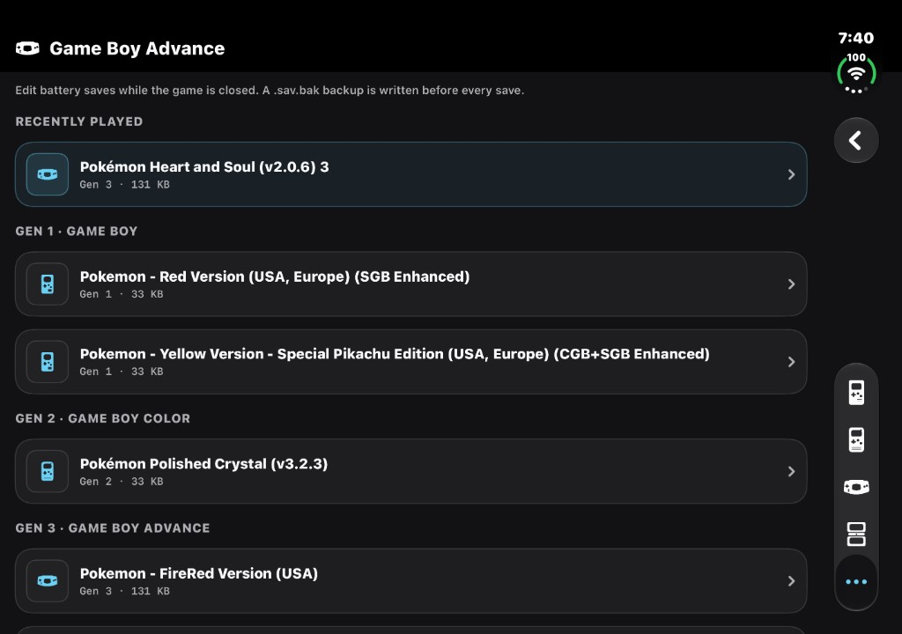
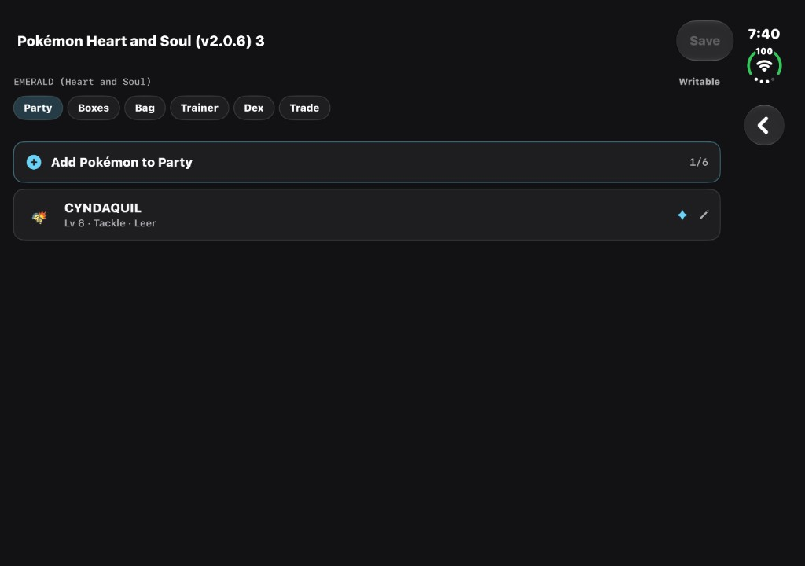

# PocketDex (iOS) — Alpha

**PocketDex** is an iOS app for playing Game Boy, Game Boy Color, Game Boy Advance, and Nintendo DS Pokémon games and popular ROM hacks on your phone — with extras aimed at making long play sessions nicer: widescreen **Expand** on supported titles, a live **Companion** HUD (party lead, battle tips), shaders, cloud save sync (optional), and a built-in **Save Editor** for optimized games.

> **Status: early alpha.** A lot still needs work. Expect bugs, incomplete features, and rough edges. Feedback from playtesters is how this gets better.

This project is **not affiliated with Nintendo, The Pokémon Company, or Game Freak.** Pokémon is a trademark of its respective owners. **You must use your own legally obtained ROM dumps.** This repository does not include commercial ROMs.

---

## AI disclosure

Large parts of PocketDex’s iOS app code and tooling were built **with the help of AI coding assistants** (including Cursor), under human direction. Treat this as an experimental alpha from an indie project — not a polished commercial release. Please be kind in feedback, and assume rough spots are known or soon to be filed.

---

## What works today (high level)

- Play GB / GBC / GBA / DS Pokémon titles you import yourself
- **Expand (widescreen)** on many optimized hacks and retail mappings
- **Companion** overlays for supported Gen 3 (and related) profiles
- **Save Editor** for many optimized games (party, bag, money, EVs, etc.)
- Display options (aspect, shaders, unlit, audio)
- Optional Google Drive sync (requires your own OAuth client setup for builds)

Optimized ROM support is documented in-app under **Settings → About → Optimized ROMs**.

---

## Screenshots

<p>
  
  
  
</p>
<p>
  
  
</p>
<p>
  
  
  
</p>
<p>
  
  
</p>

---

## What you need to build

- macOS with Xcode 15+
- Apple Developer team (signing)
- Python 3 (companion map validation / codegen scripts)
- CMake (mGBA static lib)

```bash
# From repo root — builds a development IPA when configured for your team:
bash scripts/build_ipa.sh
```

Default bundle id / team in `ios/project.yml` are for the original developer; change `PRODUCT_BUNDLE_IDENTIFIER` and `DEVELOPMENT_TEAM` for your own signing.

**Do not commit** `ios/Secrets/` (OAuth client files). Copy your own client id into Secrets or project settings locally.

---

## Playtesting & IPA downloads

Prebuilt IPAs on [GitHub Releases](../../releases) are **development / ad-hoc signed**. They only install on devices registered to the signing team — not a universal public install. Wider playtesting goes through **TestFlight**.

---

## Third-party cores

PocketDex embeds and builds on open-source emulator projects (licenses retained in their trees), including:

- [mGBA](https://github.com/mgba-emu/mgba) — GB/GBC/GBA
- [melonDS](https://github.com/melonDS-emu/melonDS) — Nintendo DS

Upstream Android / shared C++ lives under `upstream/`. The iOS app lives under `ios/`.

---

## Feedback

Open a [GitHub Issue](../../issues) with:

1. Device + iOS version  
2. Game / hack name (no ROM attachments)  
3. What you expected vs what happened  
4. Screenshot if UI-related  

Thank you for trying an alpha — it really helps.
